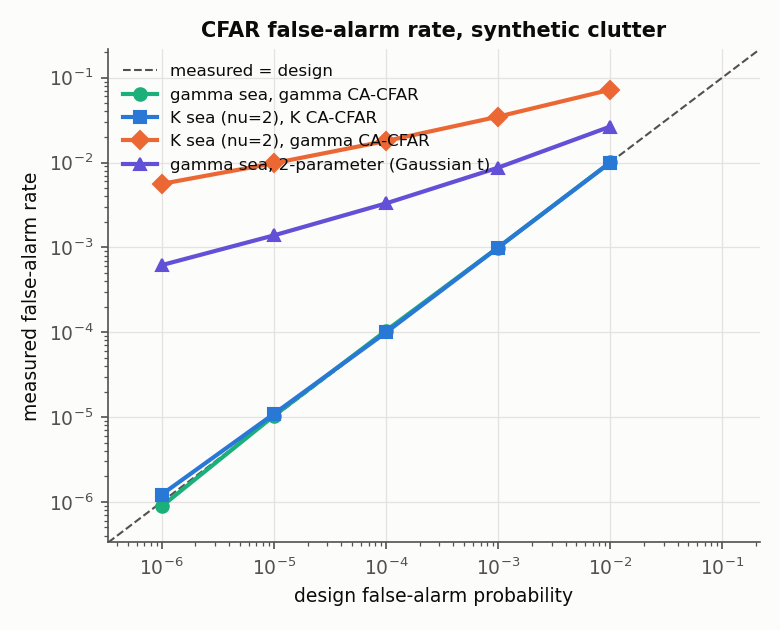
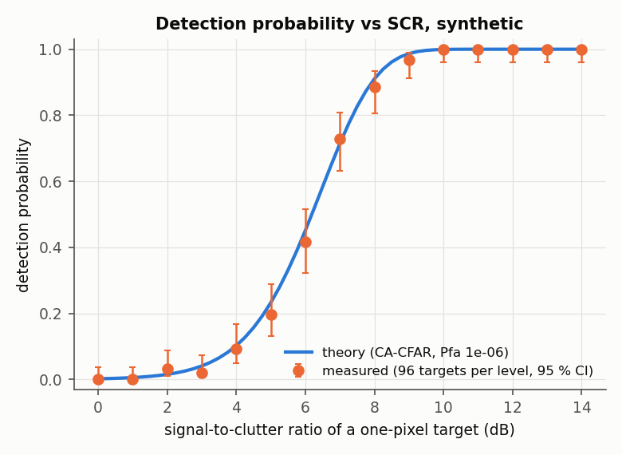
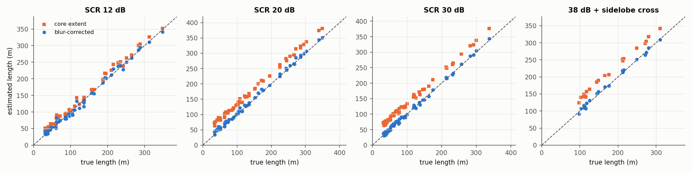
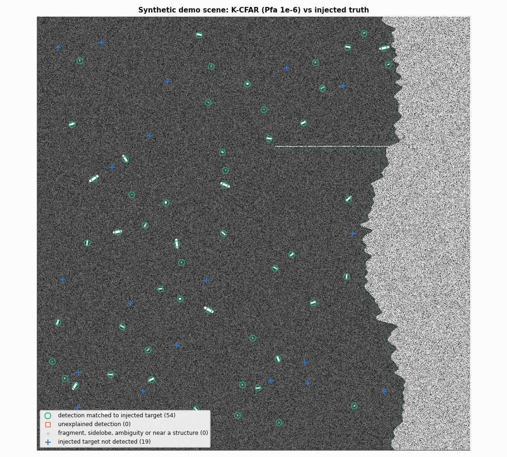
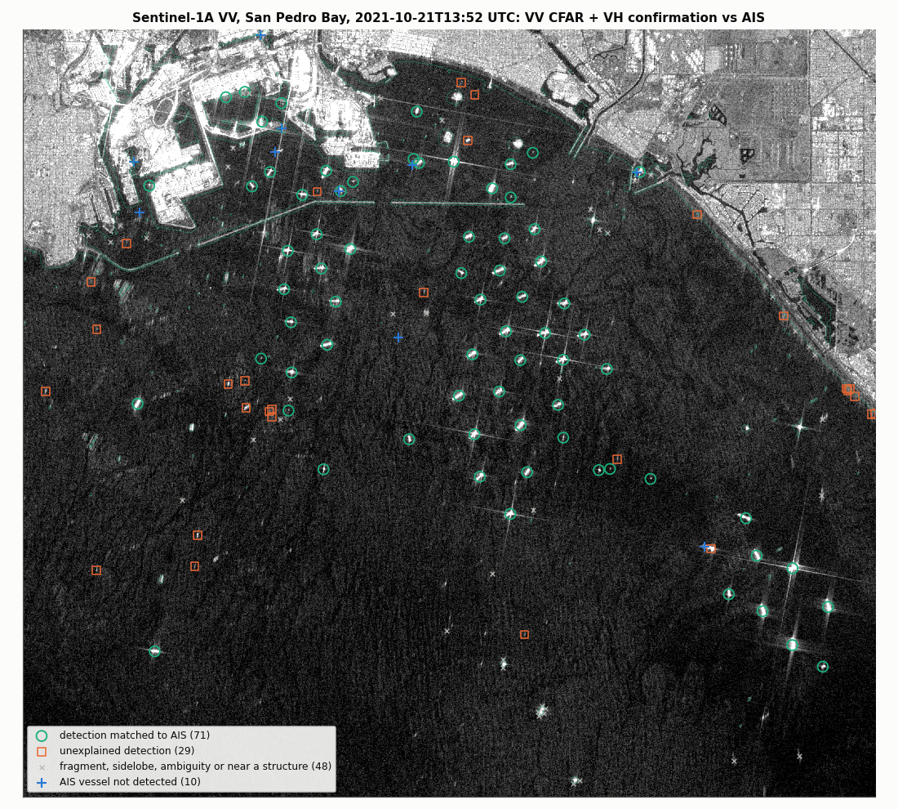
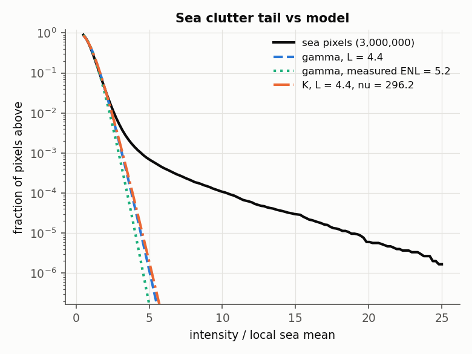
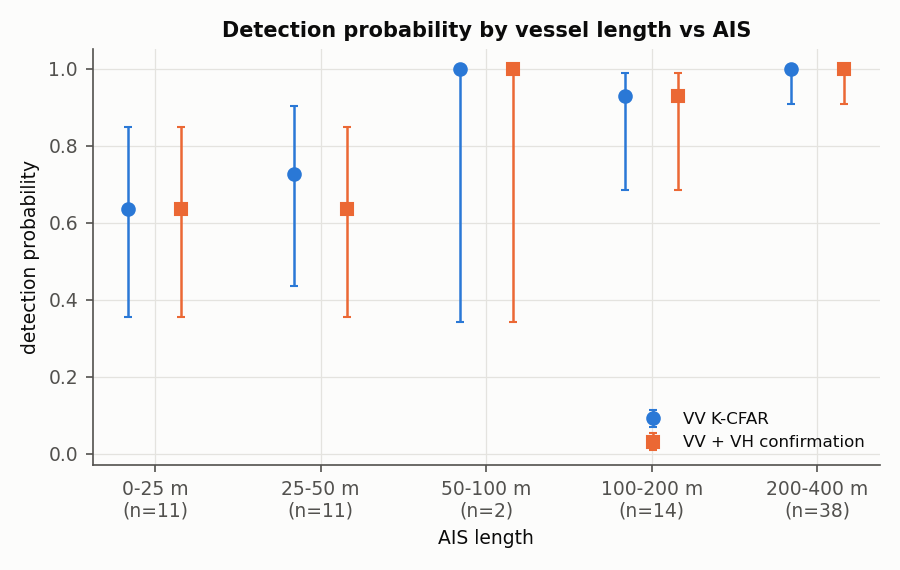
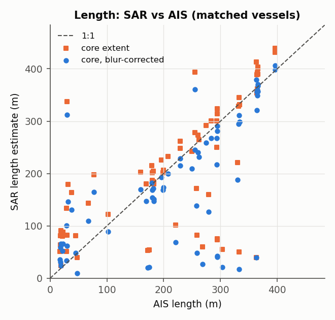
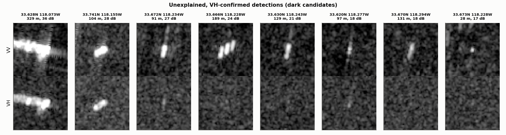

# Sentinel-1 Ship Detection, Validated Against AIS (CFAR, K-Distributed Clutter, Los Angeles / Long Beach)

A small, **validation-first** ship detector for Sentinel-1 SAR imagery. It runs a
constant-false-alarm-rate (CFAR) detector on C-band VV intensity, with gamma or
K-distributed sea clutter fitted to each scene. Land is masked, and so are fixed
structures. Detected pixels are grouped into targets with a centroid, orientation and
length. VH confirms each target, and AIS validates the result.

Most of the code is about **how the detector is checked**:

- **against injected truth.** A synthetic backend builds multi-look speckle scenes
  with point and extended targets at known positions, lengths and signal-to-clutter
  ratios (SCR). The tests check that the measured false-alarm rate equals the design
  rate, that detection probability follows the closed-form theory, and that lengths
  come back right.
- **against AIS on a real scene.** One Sentinel-1A pass over the Los Angeles / Long
  Beach anchorages on 2021-10-21 is compared with that day's MarineCadastre AIS for
  the same box. In October 2021 the port congestion had dozens of container ships at
  anchor. The comparison gives detection probability by vessel length, the rate of
  detections no AIS vessel explains, and a list of "dark" candidates.

The question is the one an analytics team asks of any detector: *what does it find,
what does it miss, and what fraction of what it reports is real?*

> ### What has been run
> | | Status |
> |---|---|
> | **pytest suite** (63 tests, offline, no network or credentials) | **Passing**: locally (Python 3.13) and in a clean Python 3.12 virtualenv with only `requirements.txt`. |
> | **Synthetic validation**: false-alarm rate, Pd vs SCR, length, censoring, demo scene | **Run** (`python scripts/run_synthetic.py`, 50 s). [Results](#1-synthetic-checks-against-injected-truth). |
> | **Real scene**: Sentinel-1A IW GRDH, 2021-10-21 13:52:59 UTC, relative orbit 71, San Pedro Bay | **Run**, read from Microsoft Planetary Computer (Sentinel-1 RTC + annotation XML, ESA WorldCover). |
> | **AIS**: MarineCadastre day file for 2021-10-21, filtered to the AOI box | **Run**: 353 MB streamed, 158,243 reports from 379 vessels kept (3.3 MB, in `data/ais/`); the raw file was deleted, its SHA-256 is in `data/manifest.json`. |
> | **Fixed-structure mask**: 9 other passes of the same orbit (2020, 2023) | **Run** (`data/structures_lalb_o71.npz`). |
> | **Detection + AIS validation** on the real scene, with an 8-variant sensitivity table | **Run** (`python scripts/run_detect.py`, 2.5 min). [Results](#2-real-scene-against-ais). |
> | **Google Earth Engine backend** (`COPERNICUS/S1_GRD_FLOAT`) | **Written, not run.** No registered Earth Engine Cloud project was available on the machine used. Command [below](#quickstart). |
> | **Docker image** | **Dockerfile written, not built here** (no Docker on the machine used). The CI workflow builds it and runs the tests in it. |
> | **GitHub Actions** (pytest on Python 3.10–3.13, synthetic smoke run, Docker build + test) | **Written, not yet run**: it runs on the first push. |
> | New York / New Jersey AOI | Configured, not run. |

The structure follows my other validation projects (`landsat89-xcal`,
`hurricane-cat-model`): one data contract with interchangeable backends, frozen small
inputs, and tests that inject a known answer and check that the code recovers it.

---

## Results at a glance

| Check | Result |
|---|---|
| False-alarm rate, synthetic, model matched to the clutter | measured / design **0.89–1.22** from 1e-2 to 1e-6, gamma and K seas |
| ...with the wrong clutter model | gamma CFAR on K sea (ν = 2): **7× to 5,600×** design; Gaussian two-parameter CFAR on gamma speckle: **2.6× to 620×** |
| Detection probability vs SCR, synthetic (15 levels × 96 targets) | within **0.035** of the closed-form CA-CFAR curve at every level |
| Length of synthetic ships, 12–38 dB SCR, with and without a sidelobe cross | blur-corrected median error **−0 to +3 m** (MAE 3–6 m); raw extent +11 m to **+765 m** |
| Real scene: detection probability vs AIS, all 78 vessels on searchable water | **0.885** VV (69/78, 95 % CI 0.80–0.94); **0.872** with VH confirmation (68/78) |
| ...by AIS length | **38/38** at 200–400 m, **13/14** at 100–200 m, **15/22** under 50 m |
| Real scene: detections with no AIS and no other explanation | **0.32 per km²** VV only; **0.059 per km²** (29 targets in 490 km²) with VH confirmation |
| Real sea clutter tail | bulk fits gamma (ENL 4.35 vs nominal 4.4), but **6.9e-4** of sea pixels exceed 5× the local mean against **1.2e-6** predicted |
| Real length vs AIS (70 matched vessels) | median error **15 %** of AIS length, bias −13 m, 57 % within ±25 %; raw extent median error 69 % |
| Moving vessels (≥ 1 kn) | Pd **0.76** (13/17) vs **0.92** (56/61) for stationary; predicted azimuth shifts up to 401 m |

The detector does what the theory says on synthetic data, and on the real scene it
finds every large ship. Its weak points are elsewhere. First, real sea clutter has a
far heavier tail than any one-point clutter model predicts: wave features and small
objects give hundreds of extra VV detections, and VH confirmation removes 80 % of
them. Second, the length of a large ship with one dominant scatterer reads short.
Third, a tug alongside a tanker can't be separated at 20 m resolution.

---

## Why this project

SAR ship detection is easy to demonstrate and hard to trust. Every bright pixel is a
candidate, and a sea surface, a breakwater, a sidelobe or a ghost can all be bright.
A detector is only as good as the evidence for its false-alarm rate and its misses.
So this repository builds each piece from the published statistics, checks each
piece against data with a known answer, and then measures the whole against an
independent record (AIS) on a real, crowded scene.

## What it does

1. **Data.** One `Scene` contract (VV, VH, water mask, UTM grid, acquisition time,
   viewing geometry) and three backends:
   - **Planetary Computer**: Sentinel-1 RTC (γ⁰, linear power, 10 m UTM) and ESA
     WorldCover, read anonymously. The platform heading, per-line zero-Doppler time,
     incidence angle and sub-swath PRFs come from the GRD product annotation XML.
   - **Earth Engine**: `COPERNICUS/S1_GRD_FLOAT` (σ⁰, linear power) and ESA
     WorldCover, fetched on the same UTM grid with `ee.data.computePixels`.
   - **Synthetic**: see below.
2. **Clutter models** (`clutter.py`). L-look gamma intensity, and the K distribution
   (gamma texture × gamma speckle) with its tail integrated numerically. ENL and
   K shape are estimated from log-cumulants, which a few bright ships barely move.
   The CA-CFAR multiplier is exact for gamma clutter (the test ratio is
   F(2L, 2NL)-distributed). For K clutter, the background estimate is moment-matched
   by a gamma and the probability is averaged over the texture. `scipy.stats.f.isf`
   (SciPy 1.15) returns wrong values once the second degree of freedom exceeds about
   5×10⁴, which an 81 × 81 window reaches, so the F quantile is written via the
   incomplete beta function; a test pins this.
3. **CFAR** (`cfar.py`). Guard window 25 × 25 px and background window 81 × 81 px,
   with sums from integral images. Background statistics use **water pixels only**
   and the multiplier is recomputed for the number of cells actually used, so the
   rate holds at the coast. Cell-averaging and two-parameter variants are included.
   An optional **censoring** pass removes first-pass detections from the background
   so that neighbouring ships in an anchorage do not hide each other.
4. **Targets** (`targets.py`). Detections within 2 px are merged into one target.
   Each target gets an intensity-weighted centroid, an orientation from second
   moments, and a length measured on its **core** (pixels within 15 dB of the peak,
   which keeps the −21 dB sidelobe cross out). The impulse-response blur is then
   removed using the published 20 × 22 m resolution and the target's
   threshold-to-peak ratio. Nothing is fitted to AIS.
5. **Masks.** Land comes from WorldCover, grown by 100 m. **Fixed structures**
   (breakwaters, platforms, pilings) come from nine other passes of the same orbit:
   a pixel brighter than 3× its local sea mean on at least half of them. For gamma
   speckle the chance of that is about 10⁻¹².
6. **AIS** (`ais.py`). The MarineCadastre day file is streamed and filtered to the
   box. Each vessel is interpolated to the SAR zero-Doppler time (reports ≤ 10 min
   apart) or dead-reckoned from a report ≤ 30 min away. It is then moved to where
   it **appears** in the image: a moving ship is displaced along-track by
   −(R/V)·v_radial, up to 400 m here.
7. **Validation** (`validation.py`). Detections are matched one-to-one to every
   in-scene vessel (Hungarian assignment, gate 200 m + half the AIS length).
   Detection probability is computed over vessels on searchable water. Each
   unmatched detection is then sorted into fragment (near a matched vessel), sidelobe
   (on the range or azimuth axis of a target ≥ 12 dB brighter), azimuth ambiguity
   (λR·PRF/2V along-track from a target ≥ 15 dB brighter, using the target's own
   sub-swath PRF), near a fixed structure (≤ 300 m), or **unexplained**. Unexplained,
   VH-confirmed detections at least 20 m long are the **dark candidates**.
8. **Synthetic backend** (`synthetic.py`). Gamma or K speckle, with independent pixels
   (for exact statistics) or spatially correlated looks filtered by the impulse
   response. Point targets and ships (rectangles with a random along-hull brightness,
   blurred, optionally with a sidelobe cross) are injected coherently in every look, so
   2L·I/μ is noncentral χ²(2L, 2L·SCR). The scene can include a coast, a breakwater,
   bright structures, dark and moving ships, and MarineCadastre-style AIS rows with the
   azimuth shift built in.

---

## Quickstart

```bash
pip install -r requirements.txt

# Tests (offline, ~35 s)
python -m pytest -q

# Synthetic validation: every number against injected truth (~1 min)
python scripts/run_synthetic.py

# Real data. Needs rasterio (Planetary Computer) and, for --backend gee, earthengine-api.
pip install -r requirements-real.txt
python scripts/fetch_data.py                      # Sentinel-1 (Planetary Computer), AIS day, structure mask (~10 min)
python scripts/run_detect.py                      # detection + AIS validation + sensitivity (~2.5 min)

# The same scene from Google Earth Engine (not run here; needs a registered EE Cloud project)
earthengine authenticate
python scripts/fetch_data.py --what s1 --backend gee --project YOUR_EE_PROJECT
python scripts/run_detect.py --backend gee --project YOUR_EE_PROJECT

# Other passes over the AOI (Planetary Computer STAC)
python scripts/fetch_data.py --list 2021-10-01 2021-10-31

# Docker: the test suite in a container
docker build -t s1ship . && docker run --rm s1ship
```

`run_detect.py` writes `results/real/` (detections with flags, AIS vessels evaluated,
Pd by length, dark candidates, clutter tail, sensitivity, `summary.json`,
`run_info.json` with settings and input checksums) and `figures/real_*.png`.

---

## Validation design

| Layer | What is checked | Against | Where |
|---|---|---|---|
| Clutter statistics | K pdf normalises; K tail = numeric integral = Monte Carlo; ENL and K shape recovered | closed forms, 1–2 M samples | `test_clutter.py` |
| CFAR threshold | measured false-alarm rate = design rate, 1e-2 to 1e-6 | pure gamma / K speckle | `test_cfar.py`, `run_synthetic.py` |
| Detection | Pd rises with SCR and follows the CA-CFAR curve | noncentral χ² theory | `test_cfar.py`, `run_synthetic.py` |
| Land and censoring | no land detections; coastal rate holds; small ships found between bright ones | synthetic coast, breakwater, anchorage | `test_cfar.py` |
| Targets | centroid, orientation, length; sidelobe fragments flagged | injected ships of known size | `test_targets.py` |
| Geometry | UTM vs PROJ; azimuth shift direction and size; ambiguity offset | pyproj reference values, closed forms | `test_geo.py` |
| AIS handling | box filter, NA codes, interpolation, dead reckoning, apparent position | hand-built CSV, synthetic AIS | `test_ais.py` |
| Whole pipeline | every detection is a real target; unmatched = exactly the no-AIS targets | demo scene with known truth | `test_validation.py` |
| Real scene | Pd by length, unexplained rate, length vs AIS, clutter tail | MarineCadastre AIS, same 25 km box, same minute | `run_detect.py` |

Nothing in the detector is fitted to AIS. The design choices (Pfa 1e-6, windows,
100 m land buffer, 15 dB core, VH Pfa 1e-4, gate) are in `config.py`, labelled
ASSUMED. The real-scene sensitivity table varies them.

---

## Results

### 1. Synthetic checks against injected truth

**False-alarm rate.** Four 1500 × 1500 images of independent speckle (9 M pixels per
case):

| Measured / design rate | 1e-2 | 1e-3 | 1e-4 | 1e-5 | 1e-6 |
|---|---|---|---|---|---|
| gamma sea, gamma CA-CFAR | 1.00 | 1.00 | 1.04 | 1.03 | 0.89 (8 vs 9) |
| K sea (ν = 2), K CA-CFAR | 1.00 | 0.99 | 0.99 | 1.09 | 1.22 (11 vs 9) |
| K sea (ν = 2), gamma CA-CFAR | 7.2 | 35 | 179 | 981 | 5,600 |
| gamma sea, two-parameter CFAR with Gaussian t | 2.6 | 8.7 | 33 | 138 | 618 |



The detector holds its rate when its clutter model is right, and the error grows
without bound as the threshold moves into a tail the model gets wrong. The textbook
two-parameter CFAR (mean + t·σ with a Gaussian t) is the clearest case: speckle is
skewed, so its "1e-6" is really 6e-4.

**Detection probability.** 1,440 one-pixel steady targets at 0–14 dB SCR, 60 px apart
(outside each other's windows), at Pfa 1e-6. Measured Pd is within 0.035 of the
closed form at every level, and rises from 0 at 0–1 dB to 1 from 10 dB.



**Length.** Ships 30–350 m long on correlated speckle, Pfa 1e-6:

| Case | Raw extent, median error | Core extent | Core, blur-corrected (MAE) |
|---|---|---|---|
| SCR 12 dB (50 ships) | +11 m | +11 m | **−0 m** (5.9 m) |
| SCR 20 dB (50 ships) | +33 m | +33 m | **+3 m** (3.4 m) |
| SCR 30 dB (50 ships) | +51 m | +35 m | **+1 m** (4.5 m) |
| 38 dB + −21 dB sidelobe cross (20 ships) | **+765 m** | +36 m | **+3 m** (5.2 m) |



The raw blur grows with SCR, exactly as the threshold-to-peak correction predicts. In
the sidelobe case, every arm fragment that breaks away is flagged as a sidelobe.

**Censoring.** 361 large ships (250 m, 30 dB) every 400 m with a 10 dB point target
between each pair: Pd of the small targets is **0.00 without censoring and 1.00 with
it**. The big ships raise every background window around them.

**Demo scene.** 1536 × 1536 px of correlated K sea (ν = 6) with a coast, a breakwater,
70 ships (lengths log-uniform 10–343 m; 2 without AIS; 23 moving at 6–16 kn) and
3 bright structures without AIS. The ship SCR follows an assumed +20 dB/decade
length relation, so the Pd values below are not predictions for real ships. What
matters is what is correct by construction:

- K-CFAR: **54 detections, all real targets**, with nothing from land, the breakwater
  or the sea. Length error +1.1 m median (MAE 5.2 m).
- Against synthetic AIS, the **4 unmatched detections are exactly the 4 detected
  targets without AIS**. Without the azimuth-shift correction only 41 of the 50
  matches are made.
- A gamma CFAR on the same textured sea: 100 false targets (0.53 per km²). VH
  confirmation removes **all 100** and keeps 59 of the 62 true detections.



### 2. Real scene against AIS

**Scene.** Sentinel-1A IW GRDH, descending, relative orbit 71, AOI-centre
zero-Doppler time 2021-10-21 13:52:59.8 UTC, incidence 39.8–41.4°. The box is
118.30–118.02 W, 33.56–33.77 N, 2359 × 2624 px at 10 m (619 km²). After the land
buffer and the structure mask, **490 km²** of water was searched. The structure mask
covers 0.78 km² of that water: the San Pedro, Middle and Long Beach breakwaters,
piers and pilings, and offshore platforms.

**AIS.** 379 vessels reported inside the box that day. 299 have a position at the
SAR time (274 interpolated between reports at most 10 min apart), 288 fall in the
image, and **78 are on searchable water**. The rest are at berth inside the land
buffer.



**Clutter.** The VV sea fits gamma in the bulk: log-cumulant ENL 4.35 against the
nominal 4.4, and a fitted K shape of ν ≈ 300, i.e. no texture at the pixel scale.
VH has ENL 6.6. The speckle is spatially correlated: the lag-1 autocorrelation is
0.81 across and 0.72 along, from the terrain-correction resampling. The tail is
another matter. On sea pixels at least 600 m from any bright target and 300 m from
any AIS vessel:

| Intensity / local mean | > 3 | > 5 | > 8 | > 15 |
|---|---|---|---|---|
| Sea pixels (3.0 M sampled) | 4.8e-3 | **6.9e-4** | 2.0e-4 | 2.9e-5 |
| gamma, L = 4.4 | 1.5e-3 | 1.2e-6 | 1.0e-11 | 3.5e-24 |



No one-point model with any ENL or K shape produces that tail. The excess comes as
compact, multi-pixel blobs: VV-only wave and streak features, small boats, buoys and
kelp. A CFAR built on per-pixel statistics treats them as targets. This is the
dominant source of VV false alarms here, and it is why the VH stage exists.

**Detections, and what explains them** (main configuration: K-CFAR fitted to the
scene, Pfa 1e-6, censoring, 100 m buffer, structure mask):

| | VV | VV + VH confirmation |
|---|---|---|
| Targets | 463 | 148 |
| Matched to AIS vessels on searchable water | 69 of 78 → **Pd 0.885** (95 % CI 0.80–0.94) | 68 of 78 → **Pd 0.872** (0.78–0.93) |
| Matched to any in-scene AIS vessel (incl. berthed) | 77 | 71 |
| Unmatched | 386 (0.79 / km²) | 77 (0.16 / km²) |
| ↳ fragment of a matched vessel | 13 | 2 |
| ↳ sidelobe of a brighter target | 40 | 3 |
| ↳ azimuth ambiguity of a brighter target | 58 | 14 |
| ↳ within 300 m of a fixed structure | 117 | 29 |
| ↳ **unexplained** | **158 (0.32 / km²)** | **29 (0.059 / km²)** |

The "unexplained" rate is an **upper bound** on the false-alarm rate. It still
includes vessels without AIS (most fishing and recreational boats, barges) and
anything else real.

**Detection probability by AIS length:**

| AIS length | VV | VV + VH |
|---|---|---|
| 0–25 m (11) | 7 (0.64) | 7 (0.64) |
| 25–50 m (11) | 8 (0.73) | 7 (0.64) |
| 50–100 m (2) | 2 | 2 |
| 100–200 m (14) | 13 (0.93) | 13 (0.93) |
| 200–400 m (38) | **38 (1.00)** | **38 (1.00)** |
| unknown (2) | 1 | 1 |



The nine missed vessels are tugs, towboats and small passenger or fishing craft of
21–40 m, plus one 174 m tanker. The tanker *was* detected: a 146 m, 34 dB target
64 m from its AIS position. But a 32 m tug lay 23 m from it, and the one-to-one,
distance-only assignment gave the target to the tug. A tug alongside at 20 m
resolution is one target. Matching on length as well would flip this case. I kept
the rule fixed before looking at the results rather than tune it.

**Moving vessels.** 17 of the 78 were moving at ≥ 1 kn, with predicted azimuth shifts
of 152 m median and up to 401 m. Their Pd is 0.76 (13/17), against 0.92 (56/61) for
stationary vessels; they are also the smaller vessels. Correcting the shift adds two
matches (69 vs 67).

**Length vs AIS** (70 matched, VH-confirmed):

| Estimator | Median error | Median \|error\| / AIS length | Within ±25 % |
|---|---|---|---|
| Raw extent (sidelobes included) | +131 m | 0.69 | 10 % |
| Core extent | +20 m | 0.15 | 56 % |
| **Core, blur-corrected** | **−13 m** | **0.15** | **57 %** |



Two failure modes account for most of the scatter. **11 of 52 ships over 150 m read
less than half their length**: one dominant scatterer (bridge, deck cargo) puts
the rest of the hull more than 15 dB down, outside the core. And **10 of 15 vessels
under 60 m read more than twice their length**: a 20 m resolution cell is as big as
the boat, and some of these are tugs matched to the tanker beside them. The
synthetic ships, with a uniform hull, did not show the first mode. That is a limit
of the synthetic model, and the AIS comparison is what exposed it.

**Dark candidates.** 29 unexplained, VH-confirmed detections at least 20 m long, in
`results/real/dark_candidates.csv`. The brightest eight:



Five of these eight are compact objects in both VV and VH: plausible vessels
without AIS, one about 100 m long. One is a large return that looks like a
structure the mask did not fully cover. Two are line artifacts, probably sidelobe
arms of ships outside the chip. *These are candidates, not identifications.*

**Sensitivity.** Each variant changes one setting from the main configuration:

| Variant | Pd, VV | Unexplained / km², VV | Pd, VV + VH | Unexplained / km², VV + VH |
|---|---|---|---|---|
| **main: K, Pfa 1e-6** | **0.885** | **0.322** | **0.872** | **0.059** |
| Pfa 1e-5 | 0.872 | 0.467 | 0.846 | 0.061 |
| Pfa 1e-7 | 0.885 | 0.261 | 0.872 | 0.055 |
| Pfa 1e-8 | 0.872 | 0.182 | 0.859 | 0.041 |
| gamma clutter (L = 4.4) | 0.885 | 0.339 | 0.872 | 0.059 |
| no censoring | 0.872 | 0.296 | 0.872 | 0.059 |
| land buffer 200 m (74 vessels on water) | 0.892 | 0.338 | 0.878 | 0.050 |
| no structure mask (80 vessels on water) | 0.850 | 0.618 | 0.850 | 0.173 |

Pd barely moves (0.85–0.89) across two decades of design Pfa, because the ships that
count are far above any of these thresholds. The unexplained rate does move, and the
structure mask and the VH stage do most of that work. K and gamma give the same
answer here because this sea has no pixel-scale texture (ν ≈ 300). The synthetic
check shows how much the choice matters on a sea that does.

---

## What the validation says

| Component | Evidence | Verdict |
|---|---|---|
| CFAR threshold | Synthetic measured / design 0.89–1.22 down to 1e-6 | **Holds** when the clutter model is right. |
| Clutter model on real sea | Bulk ENL 4.35 vs 4.4; tail 580× the model at 5× the mean | **Bulk holds, tail does not.** The excess is objects and sea features, not speckle. |
| Detection of large ships | 51 of 52 AIS vessels ≥ 100 m on water; the one miss is a matching artefact | **Holds.** |
| Detection of small craft | 15 of 22 under 50 m | **Partial**, as expected at 20 m resolution and C band. |
| False alarms | VV 0.32 / km² unexplained; VV + VH 0.059 / km² (upper bounds) | **VV alone is not enough**; dual-pol confirmation is needed in this sea. |
| Length | Synthetic: blur-corrected error ≤ 3 m; real: median 15 %, two failure modes | **Usable for size classes**, not for exact length. |
| Moving ships | Azimuth shift up to 400 m; correction adds 2 of 69 matches | **Needed**, small effect in an anchorage. |

The next steps follow from this: a length estimator that is robust to one dominant
scatterer (e.g. the extent above a fraction of the hull's median, not its peak),
matching on position *and* length, a clutter model with a discrete-scatterer
component, and more scenes (other dates, sea states and ports, including the
NY/NJ AOI already configured) to put intervals on the unexplained rate.

## Data sources

| Source | Provider | Used for |
|---|---|---|
| [Sentinel-1 RTC](https://planetarycomputer.microsoft.com/dataset/sentinel-1-rtc) and [GRD annotation](https://planetarycomputer.microsoft.com/dataset/sentinel-1-grd) | ESA Copernicus; RTC processing by Catalyst; Microsoft Planetary Computer | VV/VH γ⁰; heading, zero-Doppler time, incidence, PRF |
| [`COPERNICUS/S1_GRD`](https://developers.google.com/earth-engine/datasets/catalog/COPERNICUS_S1_GRD) (`_FLOAT`) | ESA Copernicus; Google Earth Engine | Alternative backend (not run) |
| [ESA WorldCover 10 m v200](https://esa-worldcover.org/) | ESA | Land / water mask |
| [MarineCadastre AIS, 2021-10-21](https://coast.noaa.gov/htdata/CMSP/AISDataHandler/2021/) | BOEM / NOAA Office for Coastal Management | Vessel positions, lengths, speeds |

Contains modified Copernicus Sentinel data (2020, 2021, 2023). `data/manifest.json`
records the URL, size and SHA-256 of the AIS download and of the kept subset, and the
STAC identifiers of every Sentinel-1 pass used.

## Model choices and their sources

| Piece | Choice | Source |
|---|---|---|
| Speckle | L-look gamma, nominal L = 4.4 (IW GRDH) | ESA product definition; STAC `sar:looks_equivalent_number` |
| Sea texture | K distribution, shape from log-cumulants | Jakeman & Pusey 1976; Ward 1981; Nicolas 2002 (log-cumulants) |
| CA-CFAR multiplier | F(2L, 2NL) quantile (gamma); texture-averaged (K) | Exact for independent gamma cells; moment-matched for K |
| Windows | guard 25 × 25, background 81 × 81 px | **Assumed** |
| Pfa | 1e-6 (VV), 1e-4 (VH confirmation) | **Assumed**; varied |
| Impulse response | Gaussian, FWHM 21 m; sidelobes on range/azimuth axes | S1 IW GRDH resolution 20 × 22 m |
| Core cut | 15 dB below the peak | **Assumed**; S1 sidelobes ≈ −21 dB |
| Azimuth shift | −(R/V)·v_radial along track | standard SAR moving-target geometry |
| Azimuth ambiguity | λ·R·PRF / 2V, PRF of the target's sub-swath | annotation PRFs |
| Fixed structures | > 3× local sea mean on ≥ half of 9 passes | **Assumed** threshold; dates outside the 2021–22 congestion |
| AIS gate | 200 m + ½ AIS length | **Assumed**: antenna anywhere along the hull |

## Honest scope

- **One scene, one day, one port.** Every real-data number comes from a single pass
  with 78 evaluable vessels; the intervals are wide and the sea state was calm (no
  pixel-scale texture). Another date or sea state could move the false-alarm side a
  lot.
- **AIS is not ground truth.** Many small craft do not broadcast, and positions can be
  off by the antenna offset and by report timing. "Unexplained" is therefore an upper
  bound on false alarms, and Pd is measured only on vessels that do broadcast.
- **The real scene is RTC γ⁰ from Planetary Computer, not Earth Engine σ⁰.** CFAR is
  scale-invariant, so the detector does not care. The Earth Engine path is written and
  documented but was not run, because no registered EE project was available.
- **Terrain-corrected GRD, not SLC.** Speckle is resampled and correlated, and there
  is no sub-look or phase information. Sidelobes, ambiguities and blur are handled
  with published geometry, not by reprocessing.
- **Explanations are rules.** "Sidelobe", "ambiguity" and "near structure" are
  geometric rules with assumed tolerances. They can explain away a real vessel that
  happens to sit on a bright ship's axis or next to a platform.
- **The synthetic ships are simpler than real ones.** They have uniform hulls and a
  Gaussian impulse response with an approximate sidelobe cross. The AIS comparison
  shows where that matters (length of ships with one dominant scatterer).

## Repository layout

```
sentinel1-ship-detect/
├── README.md
├── requirements.txt / requirements-real.txt
├── Dockerfile, .dockerignore           offline test image (pytest by default)
├── .github/workflows/tests.yml         pytest (3.10-3.13), synthetic smoke run, Docker build + test
├── LICENSE
├── resume_entry.tex                    draft resume entry (LaTeX, moderncv \cventry)
├── src/s1ship/
│   ├── config.py      AOIs, sensor constants, detector design (each labelled published / estimated / assumed)
│   ├── clutter.py     gamma and K models, log-cumulant estimators, CA-CFAR and two-parameter thresholds
│   ├── cfar.py        integral-image window stats, masked CA / two-parameter CFAR, censoring, clutter fit
│   ├── targets.py     clustering, centroid, orientation, core length and blur correction, VH columns
│   ├── synthetic.py   speckle scenes, injected ships / points / structures / sidelobes, synthetic AIS, Pd theory
│   ├── geo.py         UTM (Krueger series), pixel grid, slant range, azimuth shift and ambiguity offset
│   ├── scene.py       the Scene contract and its persistence
│   ├── data.py        synthetic / Planetary Computer / Earth Engine backends, annotation parser, structure mask
│   ├── pipeline.py    masks + clutter fit + CFAR + targets + VH confirmation
│   ├── ais.py         MarineCadastre download and box filter, positions at SAR time, apparent positions
│   ├── validation.py  matching, Pd by length (Wilson CI), explanations, dark candidates
│   └── plotting.py    report figures
├── scripts/fetch_data.py     Sentinel-1 scene, AIS day subset, fixed-structure mask
├── scripts/run_synthetic.py  synthetic validation -> results/synthetic, figures/synthetic_*
├── scripts/run_detect.py     real-scene detection + AIS validation -> results/real, figures/real_*
├── data/                     AIS subset, structure mask, manifest (scenes are re-fetched, not committed)
├── results/                  CSV tables, summary.json, run_info.json
├── figures/
└── tests/                    63 offline tests (pytest)
```

## Author

Ruiyao Chen, PhD: satellite remote sensing, calibration/validation and
uncertainty quantification for NASA missions (TRMM, GPM, TROPICS, PolSIR).

## License

MIT; see [LICENSE](LICENSE).
